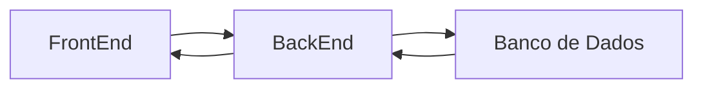
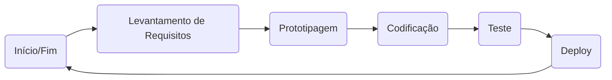

# Programação com IA Generativa
## Aula 02 - Introdução e Nivelamento 
### Módulo 1 - O que é Programação?

Programar é identificar as necessidades do usuário e desenvolver soluções para atender essas necessidades. As Soluções podem ser:

- Aplicações Web (sites)
- Aplicativos Mobile (para celular)
- Softwares Diversos (Calculadora de Fórmulas Matemáticas)

**Como um software é Feito**

* Programar um software é dar ordens extremamentes detalhadas e lógicas para um computador. é como escrever uma receita de bolo passo a passo.

* FrontEnd (A Interface do Usuário): É tudo que o usuário interage (Clica, vê e  arrasta);
* BackEnd (O cérebro): É a cozinha do Restaurante. Recebe as requisições, processa de acordo com a lógica e devolve uma resposta para UI(Interface do Usuário)
* Banco de Dados ( A memória): É onde guardamos as informações permanentes: logins, senhas, históricos, mensagens...

**O Ciclo de Desenvolvimento**

### Módulo 2 - IA Generativa

**A Base da Inteligência Artificial**

* Dados: bibliotecas de informações  como textos, páginas da web, arquivos de vídeos e imagens
* Algoritmo: A fórmula matemática  pelo qual a máquina lê os dados e identificas informações, ajustas erros. 
* Modelo: é o cérebro consolidade, criado a partir de meses de treinamento para identificação de padrões de respostas

**IA Tradicional vs IA Gererativa**

* IA Tradicional: Identifica padrões e emite classificação e previsões. Ela não cria novos conteúdos, apenas seleciona e aponta fatos com base histórica.

* IA Generativa: capaz de criar novos conteúdo aprendidos a partir da identificação de padrões estatísticos e modelos matemáticos. 

**Comparativo:**

| Dimensão | IA Tradicional (Analítica) | IA Generativa (Criativa / LLMs) |
| :--- | :--- | :--- |
| **Objetivo Central** | Analisar, classificar e prever | Criar, sintetizar, traduzir e programar |
| **Tipo de Entrada (Input)** | Tabelas de dados, valores numéricos, imagens para rótulo | Prompts em linguagem natural, trechos de código, contextos |
| **Tipo de Saída (Output)** | Números (probabilidade), categorias (Sim/Não, A/B/C) | Textos fluidos, blocos de código executáveis, arquivos estruturados (JSON) |
| **Mecanismo Subjacente** | Árvores de decisão, regressões, redes neurais convolucionais | Modelos de Linguagem de Grande Porte (LLMs), Redes Transformers |
| **Exemplo no Cotidiano** | Filtro anti-fraude do banco, recomendador do Spotify | Assistente Google Gemini, criação automática de código no Antigravity |
| **Exemplo no Software** | Ordenar produtos por chance de clique | Escrever a função de validação de formulário em JavaScript |

### Modulo 3: Preparação do Ambiente de Desenvolvimento

**Ferramentas Utilizadas:**

- Editor de Texto: VSCode
-  Editor de Texto: VSCode
- Extensões: Antigravity Google, Live Share
- Versionamento: Git e GitHub

**Configuração do GIT e do GITHUB**
Conectar Git ao GitHub, digitar o seguinte Comando no bash/cmd:

`git config --global user.name "SeuUserName"`